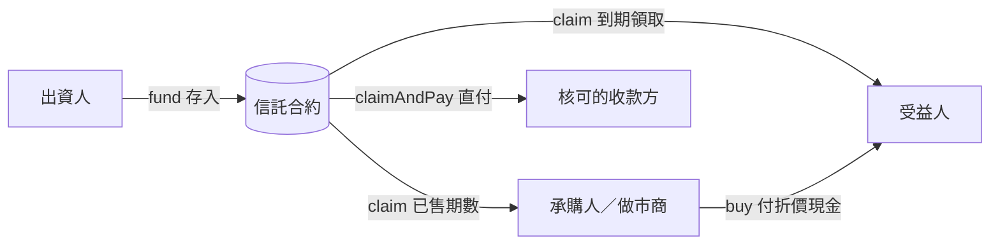

# FamilyTrust V2

可升級（UUPS）的鏈上信託：出資人存入、受益人每期領取，未來期數可以折價賣給承購人或做市商，到期款也能直接付給核可的收款方。

**網站**：https://zoo100130.github.io/familytrust-v2/
網址加 `?trust=<Proxy 地址>` 載入合約，加 `?demo=1` 看示範資料。

## 開發狀態

| 功能 | 狀態 | 說明 |
|---|---|---|
| 撥款（存入、到期領取、暫停） | ✅ 已在 Sepolia 驗證 | 出資人存入、受益人與承購人各自領取、有上限的暫停 |
| 承購市場（掛單、承購、轉讓） | ✅ 已在 Sepolia 驗證 | 掛單受年化上限保護，承購一筆交易完成付款與過戶 |
| 支付（收款方、直付、錢包付款） | ⚠️ 尚未成功 | 合約與前端已寫好，還沒在 Sepolia 完整跑通 |
| 做市商收購報價（BidBook） | ⚠️ 尚未驗證 | 合約與前端已寫好，還沒在 Sepolia 實測 |
| 升級與永久凍結（UUPS） | ⚠️ 尚未驗證 | 已用 Proxy 部署；「升級到新版本」與「永久凍結」還沒實測 |
| 資料分享（RecordConsent） | ⚠️ 尚未驗證 | 獨立合約，還沒部署實測 |

> ⚠️ 的功能請視為實驗性質，可能有錯誤，不要用在真實資金。

## 功能

| 類別 | 內容 |
|---|---|
| 撥款 | 出資人存入、每期到期由擁有者領取、有上限的暫停（只凍結受益人） |
| 承購市場 | 任何持有人都能掛單出售，售價受年化上限保護 |
| 支付 | 出資人提名、受益人同意的收款方；領取並直付、錢包付款、每段期間上限 |
| 做市商 | 常駐收購報價（資金託管）、賣給報價立即成交、轉售、轉讓 |
| 升級 | UUPS，升級管理員可升級或永久凍結 |
| 資料分享 | 受益人授權出資人查看財務紀錄（`RecordConsent`，選用） |

## 設計

### 情境與角色

子女替年邁父母設立 24 期的養老金信託。父母臨時需要一筆錢時（例如醫療），可以把未來幾期打折賣給投資人提前變現；投資人到期領全額，賺的是時間價值。

| 角色 | 信託法對應 | 能做什麼 |
|---|---|---|
| 出資人（子女） | 委託人 | 部署、存入、有上限的暫停、提名收款方 |
| 信託合約 | 受託人 | 保管資金、記錄每期歸屬、到期撥款、執行所有規則 |
| 受益人（父母） | 受益人 | 領取、出售未來期數、同意收款方、付款 |
| 承購人／做市商 | 受讓受益權的第三人 | 承購掛單、掛收購報價、到期領取、轉讓 |

### 資金流



### 核心設計決策

**1. 時間決定誰能領、什麼時候領**
- 第 i 期到期時間 = 起算時間 + (i+1) × 每期間隔，誰都不能提早領。
- 每期有一個擁有者：沒賣出屬於受益人，成交後屬於承購人。掛單不改變歸屬，掛單過期也不影響受益人領款。
- `claim()` 一次領走所有已到期、屬於自己的期數，受益人和承購人共用同一個函式。

**2. 定價：用錢的時間價值**
- 售價下限 = Σ 每期金額 ÷ (1 + 年化上限 × 距到期期數 ÷ 一年期數)，用單利折現（`PeriodPricing.presentValue`）。
- 年化上限預設 25%：售價低於這個折現值就是 `AprTooHigh`，保護賣方（長者）不被高利壓價。掛單和成交時都會檢查。
- 合約用二分法反推每張掛單的隱含年化（`impliedAprBps`），對承購人是報酬率，對受益人是提早拿錢的成本。

**3. 保護承購人**
- 沒有把錢退給出資人的函式，信託不可撤銷。
- 信託必須存足（擔保率 100%）才能掛單或成交（`NotFullyFunded`）。
- 受益人領款時，合約會保留其他持有人還沒領的部分（`_reservedForOthers`）。
- 暫停有上限（單次、累計），時間到自動恢復；只擋受益人，不擋承購人。
- 出資人握有暫停權，所以不能承購或掛報價（`SettlorCannotBuy`）。
- 承購是原子交易：付款與過戶在同一筆交易完成，沒有違約空間。

**4. 支付（尚未成功）**
- 出資人提名收款方（例如醫院、安養院），受益人同意才生效；任一方都能移除。條件改變就要重新同意。
- `claimAndPay` 把到期款直接付給收款方，其餘轉給受益人；`payFromWallet` 從受益人錢包付款並留下鏈上紀錄。
- 每個收款方在每段期間（`payWindowSeconds`）有付款上限（`PayCapExceeded`）。

**5. 做市商（尚未驗證）**
- 做市商託管資金，開出「以 X% 年化收購、最多 N 期」的常駐報價，持有人可以立即賣給報價。
- 託管的錢記在 `bidEscrow`，不算進信託資金池（`poolBalance`），避免和撥款資金混在一起。

**6. 可升級設計**
- UUPS Proxy：地址和資金不變，只換程式邏輯。只有 `upgradeAdmin` 能升級，可以交給多簽（`setUpgradeAdmin`）或永久凍結（`freezeUpgrades`）。
- 所有狀態變數集中在 `TrustStorage`：升級時只能往後加、不能刪除或調換順序，並預留 `__gap` 空位。
- 實作合約在 constructor 呼叫 `_disableInitializers()`，避免實作合約被別人初始化。

**7. 安全**
- 自訂 `nonReentrant` 防重入（狀態存在 `TrustStorage` 的 `_lock`，升級安全）。
- 先改狀態、再轉帳（Checks-Effects-Interactions）。
- 代幣轉帳一律用 OpenZeppelin `SafeERC20`。
- 所有錯誤用自訂 error 回傳，前端翻成中文說明。

**8. 前端**
- 單一 `index.html`，用 ethers.js 6 直接和合約互動，不需要後端，部署在 GitHub Pages。
- 依連線錢包自動辨識角色，顯示對應的操作頁。
- 視覺規範見 [`DESIGN.md`](DESIGN.md)：深色監控台風格，顏色只用來表達狀態。

## 檔案

| 路徑 | 說明 |
|---|---|
| `contracts/FamilyTrustV2.sol` | 組裝模組與升級權限，**部署只部署這份** |
| `contracts/FamilyTrustProxy.sol` | 手動部署 UUPS Proxy 用（Remix 的 Deploy with Proxy 不能用時） |
| `contracts/interfaces/IFamilyTrustV2.sol` | 規格書：資料結構、錯誤、事件 |
| `contracts/storage/TrustStorage.sol` | 全部狀態變數（升級時只能往後加） |
| `contracts/modules/TrustSchedule.sol` | 撥款排程：存入、每期歸屬、領取、擔保率 |
| `contracts/modules/SettlorControls.sol` | 出資人有上限的暫停 |
| `contracts/modules/ListingMarket.sol` | 承購市場：掛單、承購、轉讓、報價 |
| `contracts/modules/BidBook.sol` | 做市商收購報價：掛報價、賣給報價、取消 |
| `contracts/modules/Payments.sol` | 支付：收款方提名與核可、領取並直付、錢包付款 |
| `contracts/libraries/PeriodPricing.sol` | 時間價值純數學：現值與隱含年化 |
| `contracts/RecordConsent.sol` | 受益人授權查詢（獨立部署，不需參數） |
| `index.html` | 前端控制台（單一檔案，ethers.js 6） |
| `DEPLOY.md` | 在 Remix 匯入與部署的步驟 |
| `DESIGN.md` | 介面設計規範 |

## 繼承關係

```
IFamilyTrustV2（規格）
   └─ TrustStorage（全部狀態）
        └─ TrustSchedule（核心）
             ├─ SettlorControls
             ├─ ListingMarket ── 使用 PeriodPricing
             │    └─ BidBook
             └─ Payments
FamilyTrustV2 = Initializable + UUPSUpgradeable + SettlorControls + BidBook + Payments
```

模組之間用「掛勾」溝通：`TrustSchedule` 宣告 `_isPaused()`，由 `SettlorControls` 實作。

## 已知限制

- 定價用單利、一年固定期數，是簡化的近似。
- 代幣 FTUSD 是自己發行的測試幣，代幣 owner 仍可升級代幣合約；下一步把 owner 移交 Safe 多簽。
- 目前只在 Sepolia 測試網，代幣沒有真實價值。

舊版（不可升級合約）在 https://github.com/zoo100130/dapp_family-trust_test
